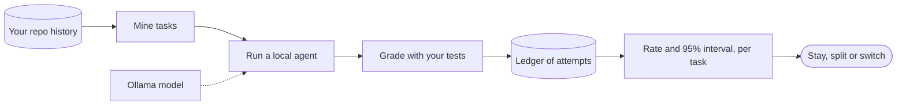
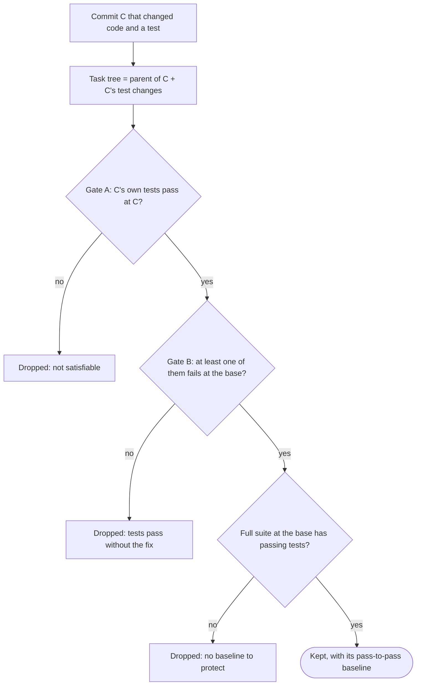
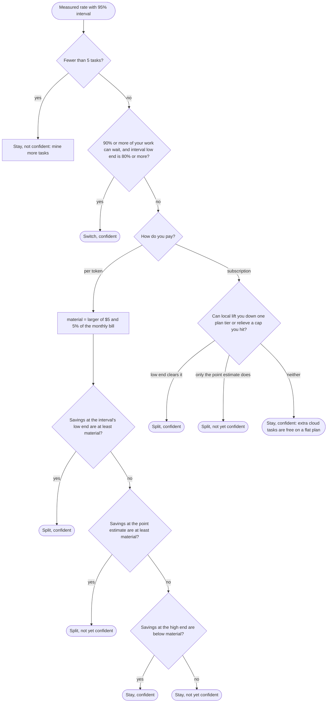
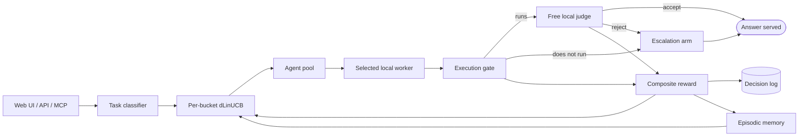

<p align="center">
  <picture>
    <source media="(prefers-color-scheme: dark)" srcset="https://raw.githubusercontent.com/pockanoodles/Mahoraga/main/brand/mark-dark.svg">
    
  </picture>
</p>

<h1 align="center">Mahoraga</h1>

<p align="center">
Mahoraga measures local coding agents on real code. It replays a repository's own commits on
a local agent overnight and grades every attempt with that repository's tests. The rate
becomes a verdict to stay on the cloud, split the work, or switch. Every result goes into a
<a href="https://kaitosoeno.com/mahoraga/">public log</a>, and for most people the answer so
far is to keep paying for cloud.
</p>

<p align="center">
  <a href="https://kaitosoeno.com/mahoraga/">The log</a> ·
  <a href="https://github.com/pockanoodles/Mahoraga#install">Install</a> ·
  <a href="https://github.com/pockanoodles/Mahoraga/blob/main/docs/RESULTS.md">Results</a> ·
  <a href="https://github.com/pockanoodles/Mahoraga/blob/main/DATAFLOW.md">Data flow</a> ·
  <a href="https://github.com/pockanoodles/Mahoraga/blob/main/CONTRIBUTING.md">Contributing</a>
</p>

[](https://github.com/pockanoodles/Mahoraga/actions/workflows/ci.yml)


## What it does

Leaderboards measure someone else's tasks on someone else's hardware, and a vendor will
rarely tell you that you don't need its product. Mahoraga measures your own work instead,
in one pipeline (source, runner, grader, ledger, verdict).

1. **Mine.** Each task is one of your commits with the fix taken out and the tests left
   in. Only commits whose own tests fail before them and pass after them are kept.
2. **Run.** A local agent (aider or opencode driving an Ollama model) attempts every task
   overnight, each time in a fresh copy of the repository, sandboxed on macOS.
3. **Grade.** The tests are put back and the full suite runs, so an attempt counts only
   when the target tests pass and nothing that passed before has broken.
4. **Decide.** The measured rate and its 95% interval, counted over tasks rather than
   attempts, become stay, split or switch, priced for the way you pay (by the token or by
   subscription) and for the time a failed attempt costs you.



Mining only keeps a commit when the tests it shipped fail without its fix and pass with
it, and the task is the commit's parent with that commit's test changes applied and every
other change (source, docs, config) left out. A task needs the commit to change both
Python source and a pytest module, and the source change to be 250 lines or fewer.



The verdict checks both ends of the interval, so it calls a split confidently only when
the pessimistic end still pays, and it is allowed to tell you that you're not wasting
money. On the published probe, aider and qwen3.5 (9.7B) resolved 5 of 18 real Mahoraga
commits on a 16 GB Mac, a rate of 28% with an interval of 12% to 51%, which is well short
of the 77% break-even for a $0.75 cloud task, so the verdict there is to stay.

### How the verdict is decided

The rules below are the ones in `backend/orchestrator/audit/verdict.py`. They run on the
task-weighted rate and its Wilson interval, which uses the number of tasks and not the number of attempts, because repeats
of one task are not independent draws. A queued task is one that can wait for an overnight
run, and by default 25% of your cloud tasks count as queueable. Each failed local attempt
is charged 3 minutes of your time at $50 an hour, and each attempt is charged its
electricity (40 W at $0.30 per kWh).



For a per-token user, the savings on queued tasks are `p × cloud cost − local cost − (1 − p) × triage cost`, evaluated at the low end,
the point estimate and the high end of the interval. A task pays to go local once `p` passes `(local + triage) / (cloud + triage)`,
which is the break-even rate the verdict prints (77% for a $0.75 cloud task on the published probe). For a subscription user, the
low end must clear the rate needed to drop a tier, or the user must already be at the cap with
the low end covering at least 10% of their usage. Every assumption prints with the verdict so a reader can disagree with a number
and not only with the call.

One rule runs after the call. A timeout can only lower a rate, so when at least 3 failed
attempts ran out of time and they make up half or more of the failures, the rate is a floor
set by the machine's speed. A split or switch read off it still stands, but a stay becomes
not yet confident, and the verdict says that a longer `--timeout` or a smaller context would
measure the model instead.


## Install

The PyPI name is `mahoraga-audit` (the name `mahoraga` belongs to an unrelated project).
The command you run is `mahoraga`.

| Channel | Command | Status |
| --- | --- | --- |
| uv | `uv tool install mahoraga-audit` | with the first release |
| pipx | `pipx install mahoraga-audit` | with the first release |
| pip, in a virtualenv | `pip install mahoraga-audit` | with the first release |
| Homebrew | `brew install pockanoodles/tap/mahoraga` | after the first release |
| Docker | `docker run --rm -p 127.0.0.1:8000:8000 ghcr.io/pockanoodles/mahoraga` | after the first release |
| From source | `uv tool install git+https://github.com/pockanoodles/Mahoraga` | CLI and API, no prebuilt app |

uv and pipx give Mahoraga an environment of its own, which its exact pins (uvicorn, httpx
and mcp) need. Installed with plain pip into an environment other tools share, those pins
can clash with theirs, so give it a virtualenv there.

Mahoraga needs Python 3.12 or newer, and it runs on macOS and Linux. It was built on a
16 GB Mac. The router's memory is an extra, `mahoraga-audit[router]`, and it is the only
part that needs a C++ toolchain to install. The Docker image serves the engine and the app,
while Ollama and your agents stay on the host. The Dockerfile's header has the full command,
including the volume that keeps your results.

### What the audit runs

The audit drives two programs that Mahoraga doesn't install. [Ollama](https://ollama.com/download)
serves the model, and aider is the agent. Install aider in an environment of its own, at the
version the published log measured, because its pins would clash with Mahoraga's:

```bash
uv tool install --python 3.12 aider-chat==0.86.2
```

Before it queues anything, `mahoraga audit tonight` checks both. The doctor command,
`mahoraga audit doctor`, runs the same checks on their own and prints the install line for
anything missing.

## Quick start

```bash
ollama pull qwen3.5:latest

mahoraga demo                                   # the app, on the published probe
mahoraga audit tonight ~/code/app \
    --tasks-per-month 200 --plan claude-max-5x  # set up a night of runs on your repo

# the next morning
mahoraga audit report ~/code/app
mahoraga audit verdict ~/code/app --arm aider:qwen3.5:latest@ctx=131072 --cond blind
```

`mahoraga demo` copies the published 18-commit probe into a scratch directory and opens
the app on it, so you can look around before a night of runs.

`mahoraga audit tonight` does the setup in one go. It mines up to 25 tasks from the
repo's commits that changed both code and a test, checks that the agent, Ollama and the
model are there and that the agent can't see the answer, and queues the run for
21:00–08:00. It then starts the background worker (under launchd on macOS) and tells you
how many nights the run will take. The verdict also needs how many tasks you give cloud
agents a month and how you pay for them. Pass them as above, or `tonight` asks once in
the terminal. They're saved in `usage.json` next to your benches and never leave the
machine. When the window closes, the report and the verdict are written next to the bench
and a notification gives the resolved count and the call. Each step also has its
own command (`mine`, `doctor`, `queue add`, `service install`) for when you want to run
it by hand. `orch` still works as an alias for `mahoraga`, and `orch agentbench` for
`mahoraga audit`.

To work on Mahoraga itself:

```bash
git clone https://github.com/pockanoodles/Mahoraga.git mahoraga
cd mahoraga
python3 -m venv .venv && source .venv/bin/activate
pip install -r requirements.txt && pip install -e .
scripts/build_ui.sh        # builds the app into the package
mahoraga serve
```

## Interfaces

The engine is headless. The CLI, the HTTP API and the MCP server are three ways into the
same code, and the app is one more client of the API.

- **CLI:** `mahoraga --help`
- **HTTP API and the app:** `mahoraga serve` (add `--headless` to serve the API alone).
  The app opens at `http://127.0.0.1:8000`, and the audit lives under `/api/audit/`.
- **MCP:** `mahoraga mcp`, for example `claude mcp add mahoraga -- mahoraga mcp`. The
  bridge provides nine tools for task execution, route previews, health, agent status,
  routing statistics, and runtime policy changes. See the [MCP guide](docs/mcp.md).
- **macOS background service:** `mahoraga service --help`. A launchd job inherits no
  shell environment, so daemon settings come from `~/.mahoraga-v2/service.env`
  (`KEY=VALUE` per line), applied by `mahoraga service install`.

<picture>
  <source media="(prefers-color-scheme: dark)" srcset="https://raw.githubusercontent.com/pockanoodles/Mahoraga/main/docs/assets/app/verdict-dark.png">
  
</picture>

## The routing layer

The audit decides what share of your work local can take, and the router is the stage
that acts on that verdict by serving it. It answers a task with a free local model, has a
second free local model judge the answer, and pays a frontier model only for the tasks that
failed.


Strong cloud models answer coding tasks well and charge for every call. Small
models run free on a laptop and get more of the hard ones wrong. Choosing
between them means either paying for every task, or accepting the worse
answers.

Mahoraga does not choose. It runs the free local model first, checks the answer
with a free local judge, and escalates to the paid model only when the judge
rejects. The bill then scales with how often the local model actually fails
rather than with how many tasks there are.

**Measured live, end to end, on the 164-task HumanEval+ benchmark:** the
cascade reached a verified pass@1 of **0.921**, **94.4% of what the cloud
model scored on its own**, at **$8.47 per 1,000 tasks instead of $35.97, a
76.5% cost cut.** On a 16 GB laptop, with the judge running free and local.

Every figure in this README is recomputed from the per-case results committed
to this repo by `orch bench verify`, in about a second, with no models, no
network, no API key and no GPU. Reproduce the run itself on your own hardware
with [`orch bench repro`](#reproduce-the-benchmark). Full method, replication,
and limits: [`docs/RESULTS.md`](docs/RESULTS.md).


That runs on a fresh clone. Regenerate the recording with
`vhs demo/verify.tape`.

Mahoraga currently runs two local Ollama arms:

| Arm | Model | Role |
| --- | --- | --- |
| `ollama:qwen3.5` | `qwen3.5:latest` | Code, planning, general work, and judge duty |
| `ollama:granite4.1-8b` | `granite4.1:8b` | Tests, reviews, and structured output |

The roster is controlled by [`agents.yaml`](agents.yaml). Cloud and CLI
adapters, including a `claude-cli` arm that captures real per-task cost for
benchmarks, remain available but are disabled in the committed
configuration.

### How it works

The serving path has two tiers, and they do not carry equal weight in this
repo. **The verification cascade is the tier that carries the numbers.** Agent
selection is architecture, see the honest accounting below.

### The cascade

On code-like buckets, an answer known to be bad is not served:

1. A free local arm answers the task.
2. The **execution gate** tries to run the output. Code that does not execute
   is rejected before it can be served or rewarded. This is a conservative
   runnable-code check, not a proof of correctness.
3. A **free local judge** reads the prompt and the output and returns a
   verdict.
4. Either rejection re-runs the task on an **escalation arm** (`claude-cli` by
   default) and serves *that* answer instead of the known-bad one.

Both triggers matter: the execution gate catches output the judge never sees,
because a failure to run flips the task to failed before the judge is reached.



Two invariants, both test-pinned. The escalation arm sits **outside** the
bandit's action space, so the policy can never route to it on its own, only a
rejection reaches it. And escalation never re-attributes: the bandit still
observes the local arm's own output, and escalation spend is recorded against
the escalation arm rather than the local one, so a second tier cannot launder a
failure into a reward. Configure with `MAHORAGA_CASCADE=off`,
`MAHORAGA_ESCALATE_TO`, and `MAHORAGA_ESCALATE_MAX_PER_DAY` (default 25).

### Agent selection, and what it does not claim

Which local arm answers first is chosen online:

1. A keyword classifier assigns the task to a capability bucket such as
   `code`, `debug`, `plan`, `research`, or `review`.
2. A per-bucket discounted LinUCB policy (`linucb_per_bucket`) selects from the
   healthy agents, using a nine-dimensional context vector and discounted
   updates for non-stationary agent performance.
3. Mahoraga computes a reward from success, quality, speed, and cost, and
   updates the policy and episodic memory for the next decision. Semantic
   episodic memory uses `all-MiniLM-L6-v2` when its optional dependency is
   installed, and falls back to handcrafted context retrieval otherwise.

**This repo does not claim the bandit improves routing.** In head-to-head
evaluation it never beat round-robin between the two local arms, the arms are
not separable *as arms* on these banks, and the reward was independently
verified not to be the cause. It is architecture here, not a result, and
[`docs/RESULTS.md`](docs/RESULTS.md) says so in the same words.

It is kept for two reasons. The measurement it produces is itself a finding
(the per-prompt oracle beats the best single arm by 11.6 points, which is what a
*semantic* router would have to capture), and the reward path, decision log and
per-task cost accounting it requires are what make the cascade measurable at
all.

The reading judge adds a few seconds per task. The generated-test check
(`MAHORAGA_REWARD_JUDGE=code`) raises fail-recall from 0.688 to 0.784 but costs
minutes of local inference per task on a 16 GB machine, so it is not a sensible
global default for interactive use. Request it per task instead with
`"thorough": true` on `/api/task`, or the `thorough` argument on the MCP
`run_task` tool.

## Routing and rewards

The context vector captures task length, code density, question shape,
complexity, mentioned files, error/creation/research keywords, and live queue
depth. Each capability bucket keeps independent LinUCB matrices so an agent can
be preferred for one kind of task without dominating unrelated work.

The reward is:

```text
reward = w_success·success + w_quality·quality + w_speed·speed + w_cost·cost
```

Weights are bucket-specific and can be learned from observed outcomes. A budget
pacer, drift detector, and quarantine state protect the live policy. All
routing state is local under `~/.mahoraga-v2/`.

Cost is real, not estimated: the `claude-cli` worker records the CLI's
authoritative per-task dollar figure, local workers record token counts, and
`orch bench report cost` computes the dollars avoided by local routing against
a cloud reference model, offline, with zero new inference.

## Evaluation and the escalation cascade

Three committed prompt banks ground the benchmarks:

- [`experiments/prompts_humaneval_plus.jsonl`](experiments/prompts_humaneval_plus.jsonl): the 164-task HumanEval+ suite converted to the verifiable-bank schema:
  hidden tests with expected outputs precomputed from the canonical solutions.
  Regenerable from the EvalPlus release with
  [`experiments/build_humaneval_bank.py`](experiments/build_humaneval_bank.py).
  A CI test guards the committed bank against rot.
- [`experiments/prompts_verifiable.jsonl`](experiments/prompts_verifiable.jsonl): 50 code/debug tasks with hidden tests. A CI guard executes every reference
  solution and every labeled mutant on each run, so the bank cannot rot
  silently.
- [`experiments/prompts_nonverifiable.jsonl`](experiments/prompts_nonverifiable.jsonl): 30 prose tasks (explain, factual, reason, summarize, instruct) with no
  oracle. Ground truth is built in: each row pairs a hand-authored correct
  reference with a subtly flawed, length-matched mutant carrying one labeled
  defect.

On top of the banks sits an escalation cascade: a free local arm answers
first, a local LLM judge, seeing only the prompt and the output, never the
hidden tests, votes on the answer, and only judged failures escalate to the
cloud arm. The headline result is the full HumanEval+ bank, run live end to
end (per-case results committed at
[`experiments/live_route_humaneval_164.jsonl`](experiments/live_route_humaneval_164.jsonl)):

| Policy | pass@1 | $/1k tasks |
| --- | --- | --- |
| Always cloud (`claude-cli`, Sonnet) | 0.976 | $35.97 |
| Always local (`granite4.1-8b`) | 0.805 | $0.00 |
| Routed: local → judge → cloud | **0.921** | **$8.47** |

The routed cascade recovers about two-thirds of the quality gap between the
free local arm and the cloud arm at a 76.5% cost cut. The judge's fail-recall
is 0.688: it catches roughly seven in ten true local failures and escalates
them, and the rest are served wrong, which is the quality price of the cost cut.

An earlier 50-task run on the smaller homemade verifiable bank was friendlier
to the judge, it caught all six true local failures (accuracy 0.920), so the
cascade matched cloud quality outright:

| Policy (50-task homemade bank) | pass@1 | $/1k tasks |
| --- | --- | --- |
| Always cloud (`claude-cli`) | 1.000 | $47.66 |
| Always local (`granite4.1-8b`) | 0.880 | $0.00 |
| Routed: local → judge → cloud | **1.000** | **$10.54** |

On the non-verifiable bank the same judge scores 0.867 accuracy while
accepting every correct reference. A tool-augmented mode has the judge write
and execute a sandboxed Python solver for computable claims, manufacturing
the hidden test the task lacks. It is recall-only (it can flip an accept to a
reject, never the reverse) and raises accuracy to 0.900 without rejecting a
single correct answer.

### Benchmarks and trademarks

The comparisons in this README are independent measurements on the author's own code and
machine, and your own run will give your own numbers. Product and model names (Claude,
Sonnet, Qwen, Granite, aider, opencode, Ollama and others) belong to their owners and
imply no endorsement. Each result is tied to the model versions, settings and date stated
beside it, and a different version or setting can move it.

```bash
orch bench verify                              # recompute every published figure from its artifact
orch bench repro                               # reproduce the headline HumanEval+ run
orch bench live-route --bank experiments/prompts_verifiable.jsonl  # live cascade, any bank
orch bench report route-sim -i results.jsonl   # counterfactual policies, zero new inference
orch bench report judge-gate                   # judge accuracy against the oracle
orch bench report judge-bank --tool            # judge on the non-verifiable bank
orch bench report cost                         # dollars avoided vs a cloud reference
orch bench report verify --input results.jsonl --bank experiments/prompts_verifiable.jsonl
```

Only run trusted evaluation data: the live execution gate, the offline
verifier, and the tool-augmented judge all execute generated code locally.

The cascade on the live serving path, a local arm answers, the free local
judge rejects, and only then does the task reach a paid arm:


Regenerate with `vhs demo/cascade.tape`. The take is not deterministic: judge
fail-recall is 0.688 and the local arm does not fail on demand, so roughly one
run in four escalates.

## Reproduce the benchmark

Reproducibility here has a cheap half and an expensive half, and they answer
different questions.

**Does the README match the data?** Run `orch bench verify`. It recomputes every
published figure from the per-case JSONL it was derived from and requires it to
round to exactly the printed value. It needs no models, network, API key or
GPU, and it runs in milliseconds on a fresh clone and in CI on every push, so a headline
number cannot be edited without the artifact to back it. Published claims are
declared in [`experiments/claims.json`](experiments/claims.json). The full
method and limits are in [`docs/RESULTS.md`](docs/RESULTS.md).

**Is the data real on my hardware?** Run `orch bench repro`, below.

The headline HumanEval+ table above reproduces with one command on a fresh
clone. Prerequisites:

- A 16 GB Apple Silicon Mac (the hardware behind the published numbers), or
  comparable.
- Ollama running, with both models pulled:

  ```bash
  ollama pull granite4.1:8b    # local arm
  ollama pull qwen3.5:latest   # escalation judge
  ```

- A cloud arm, either way of authenticating:

  | Arm | Needs | Use when |
  | --- | --- | --- |
  | `--cloud-arm claude-cli` (default) | `npm install -g @anthropic-ai/claude-code`, then `claude` once interactively | You have a Claude subscription; this is what the published run used. |
  | `--cloud-arm claude` | `export ANTHROPIC_API_KEY=...` | You do not. No subscription required. |

  Both arms run the same model and are handed the identical prompt, so the
  routed pass@1 comparison holds either way. Expect the always-cloud *dollar*
  column to differ, since API and subscription bill differently, the published
  cost figures are the `claude-cli` ones.
- The repo installed per the quick start (`pip install -e .`). The API server
  does not need to be running. The benchmark drives the workers directly.

```bash
orch bench repro --preflight-only   # check the environment; no inference, no spend
orch bench repro --smoke            # first 5 tasks end to end, ~5 minutes
orch bench repro                    # full 164 tasks, ~3.5 hours
```

`orch bench repro` first preflights the environment (Ollama daemon, both
models, `claude` binary, bank file) and fails in seconds with the fix if
anything is missing. It then runs the exact published configuration through
`orch bench live-route`: granite4.1-8b answers, qwen3.5 judges, judged
failures escalate to `claude-cli`. Per-case results land in
`experiments/repro_<date>.jsonl`, and the policy comparison table prints at
the end (`--json` for machine-readable output). By default the cloud arm also
runs on kept-local tasks to measure the always-cloud baseline, and `--local-only`
skips that spend and drops the baseline row.

Expect small run-to-run variance in pass@1: local decoding is not
seed-pinned, and the judge is itself an LLM. The bank is committed, and
regenerable from the EvalPlus v0.1.10 release:

```bash
python experiments/build_humaneval_bank.py fetch
python experiments/build_humaneval_bank.py build
```

## Monitoring

The metrics commands read the decision database directly. The server does not
need to be running.

```bash
orch metrics live
orch metrics live --watch 30
orch metrics snapshot
orch metrics usage --since 2026-08-01
orch quarantine list
orch budget status
```

`orch metrics usage` answers the question the benchmarks cannot: of the real
work actually sent to Mahoraga, how much did a free local model handle, and
what did that avoid? It reports local share, escalation rate split by trigger,
judge verdicts, and spend.

Its counterfactual is self-calibrating. Rather than pricing locally-served
tasks off a rate table, the baseline is the escalation arm's **own measured
per-task cost on the same machine in the same window**, every escalation
records what it actually charged. With no priced escalation in the window, the
report says the avoided spend is unknown rather than guessing. Bench rows are
excluded, since one forced-explore run would otherwise swamp a month of use.

This is a substitution baseline, what those tasks would have cost on the
escalation arm, not a measure of interactive-session spend, which carries
conversation context and costs considerably more.


### The delegation funnel

`orch metrics usage` measures what happened to work that *arrived*. It cannot
see the work that never did, and the cascade saves nothing on a task that is
never delegated, so that unmeasured step bounds every other number here.

`orch metrics funnel` closes it. A Claude Code `PostToolUse` hook
([`scripts/claude_code_funnel_hook.py`](scripts/claude_code_funnel_hook.py))
records one line per code-producing action, both delegations and files written
inline, and the report gives the ratio:

```bash
orch metrics funnel --install-hint    # print the hook config
orch metrics funnel --since 2026-08-12
```

The recorder logs no file contents, only derived shape (path, extension, line
and character counts), writes to `~/.mahoraga-v2/funnel.jsonl`, and exits 0 on
any failure, a measurement that can interrupt the work it measures gets
uninstalled, and then it measures nothing.

**The reported rate is a lower bound.** A hook cannot tell whether a file needed
conversation context to write, so the denominator counts everything *shaped*
like delegable work. Actions that clearly are not (in-place edits, non-code
files, and writes too small to be worth a round trip or too large for a
context-free 8B) are excluded and reported with their reason, so the
definition is arguable rather than asserted.

The default decision log is
`~/.mahoraga-v2/routing_decisions.db`.

## Privacy

The audit sends nothing off your machine, and the router sends a task to a cloud model
only when its local answer fails and the cascade is on. [`DATAFLOW.md`](DATAFLOW.md) lists
every place data can go, and the privacy policy is at
[kaitosoeno.com/privacy](https://kaitosoeno.com/privacy).

## Documentation

- [Documentation index](docs/README.md)
- [Getting started](docs/getting-started.md)
- [Configuration](docs/configuration.md)
- [CLI reference](docs/cli-reference.md)
- [MCP integration](docs/mcp.md)
- [Experiments and evaluation](docs/experimentation.md)
- [Design specifications](docs/specs/)
- [Current research state](brain/state/current_state.md)

The files under `docs/specs/` describe designs and research plans. Their status
headers may refer to the point at which they were written. Use the operator
guides and running CLI help for current behavior.

## Development

```bash
pytest -m "not slow"
```

The project uses `main` as its single trunk. Changes are made on short-lived
branches, validated in CI, and merged through pull requests.

## Limitations

- **The contextual bandit is not shown to improve routing.** Across three
  evaluations it never beat round-robin between the two local arms. The
  learning machinery is real and running. The claim that it routes better is
  not supported, and nothing in this repo depends on it. The cascade carries
  every published number.
- **Every headline figure is a 16 GB result**, which bounds who it generalises
  to. The local arms and the judge are all models that fit in 16 GB of unified
  memory alongside the OS, a machine with more memory would be running
  different, better models on both tiers, and the cost-quality tradeoff would
  move.
- The committed roster expects local Ollama models and is tuned for a single
  16 GB development machine.
- State is global to one local user. There is no multi-tenant isolation.
- Quality scoring is useful for routing but remains heuristic outside the
  execution-verified code/debug paths.
- The judge-gated escalation cascade is live on `/api/task` (and therefore the
  MCP bridge), but its measured numbers come from `orch bench live-route` on
  committed banks. Organic traffic has no oracle, so the serving path reports
  which tier answered, not whether the answer was right.
- The judge has a structural blind spot on prose tasks: it reliably catches
  stated falsehoods but misses omissions and most wrong quantities unless the
  tool-augmented solver can compute the answer.
- The CLI has a legacy port split: `orch serve`, MCP, and live bench commands
  default to port 8000, while mission/run/task and several older HTTP clients
  currently target port 8001. The [CLI reference](docs/cli-reference.md)
  identifies the affected commands.
- Running generated code is not sandboxed strongly enough for untrusted input.

## Motivation

The LLM tooling ecosystem has three established layers, each solving a different part of the problem:

**Gateways** (LiteLLM, Bifrost, OpenRouter) normalize provider APIs with a unified interface, failover and load balancing across OpenAI/Anthropic/etc. Their routing is rule-based and doesn't adapt.

**Trained routers** (RouteLLM, LLMRouter) learn to route between models, typically a strong/weak pair, using classifiers trained offline on Chatbot Arena preference data. RouteLLM achieves up to 85% cost savings on cloud-to-cloud routing. But the policy is frozen at training time, routes between two model endpoints, and assumes cloud inference throughout.

**Orchestration frameworks** (CrewAI, LangGraph, Microsoft Agent Framework) coordinate multi-agent workflows, they define what agents *do*, not which agent to dispatch for a given task.

The gap Mahoraga was built to probe: no existing system learns *online* which heterogeneous agent to route to, across a pool that spans local models at zero marginal cost alongside cloud APIs.

**What came back is worth stating plainly.** Online *selection between arms* did not pay, the two local arms are not separable as arms on these banks, and the per-prompt oracle's 11.6-point margin over the best single arm says the remaining signal is per-prompt, not per-arm. What did pay was the tier below selection: **verify the free answer, and buy the expensive one only when verification fails.** The interesting question turned out to be not *which model* but *whether this one's answer is good enough*, and answering that locally, for free, is where the cost cut comes from.

Mahoraga extends the trained-router category in three ways: online feedback rather than offline training, N heterogeneous agents (CLI tools, local models, cloud APIs) rather than two model endpoints, and local inference as the default cost tier rather than cloud escalation. The bandit accumulates experience from every routing decision and gets incrementally better with no retraining step and no deployment cycle.

## Related work

**Foundational:**
- **LinUCB** (Li et al., WWW 2010): the contextual bandit algorithm Mahoraga uses for routing. Originally applied to news article recommendation. The per-arm A/b update rule and UCB exploration bonus are directly adopted here.
- **RouteLLM** (Ong et al., 2024): the paper that established learned LLM routing as a problem worth solving. Trains 4 routers (matrix factorization, weighted Elo, BERT, causal LLM) on Chatbot Arena preference data. Binary strong/weak routing, offline, cloud-only. Mahoraga extends it to N heterogeneous agents with online learning.

**Online / bandit routing:**
- **BaRP** (Anonymous, ICLR 2026 submission): multi-objective contextual bandit for LLM routing with REINFORCE policy gradient. Validates the bandit framing. Paper only, no runtime. Mahoraga's two-stage bucketing (keyword classifier → per-bucket bandit) should accelerate convergence by narrowing the action space before the bandit runs, analogous to a hierarchical bandit.
- **LLM Bandit** (Li, arXiv 2025): multi-armed bandit with preference conditioning. Partial online learning. Offline pretraining requires full-information labels.
- **MAR** (Zhang et al., 2025): multi-armed router that avoids full-information supervision.
- **C2MAB-V** (Dai et al., 2024): combinatorial contextual volatile MAB. Online feedback, no preference tuning.

**Cost-aware cascading:**
- **FrugalGPT** (Chen et al., 2023): LLM cascade: try cheap first, escalate on failure. Sequential rather than learned. Mahoraga's escalation path (local → judge → cloud) implements the same intuition with a free local LLM judge replacing the fixed threshold.
- **AutoMix** (2024): routes to larger LMs based on approximate correctness of smaller LM output. Complementary. Mahoraga could use AutoMix-style correctness detection as a reward signal.

**Warm start and non-stationarity:**
- **PILOT** (Panda et al., EMNLP 2025): warm-starting LinUCB from preference priors reduces regret by Ω(‖θ*−θ_prior‖²). Mahoraga applies this via the benchmark compatibility matrix (`orch benchmark simulate --save-matrix`).
- **ParetoBandit** (Taberner-Miller et al., March 2026): geometric forgetting for non-stationary LLM routing. Mahoraga's dLinUCB discount factor (γ=0.98) applies the same mechanism.

**Context:**
- **Bouneffouf & Feraud: "Bandits, LLMs, and Agentic AI"** (AAAI 2026 Tutorial, IBM Research), a survey of how bandit algorithms support adaptive decision-making in agentic systems. Validates the research direction.

What no existing paper addresses: local hardware state as a routing context feature, HNSW episodic memory for prompt-level priors, and OLS-learned reward weights from implicit user signals.

## References

```
Li, L., Chu, W., Langford, J., & Schapire, R. E. (2010).
  A Contextual-Bandit Approach to Personalized News Article Recommendation.
  WWW 2010. [The LinUCB paper]

Ong, I., Almahairi, A., Wu, V., et al. (2024).
  RouteLLM: Learning to Route LLMs with Preference Data.
  arXiv:2406.18665. https://github.com/lm-sys/RouteLLM

Anonymous (2025/2026).
  Learning to Route LLMs from Bandit Feedback: One Policy, Many Trade-offs.
  ICLR 2026 submission. [BaRP]

Li, Z. (2025).
  LLM Bandit: Cost-Efficient LLM Generation via Preference-Conditioned Dynamic Routing.
  arXiv:2502.02743.

Chen, L., Zaharia, M., & Zou, J. (2023).
  FrugalGPT: How to Use Large Language Models While Reducing Cost and Improving Performance.
  arXiv:2305.05176.

Panda, A., et al. (2025).
  PILOT: Preference-Informed LinUCB with Transfer for Online Routing.
  EMNLP 2025.

Taberner-Miller, E., et al. (2026).
  ParetoBandit: Multi-Objective Non-Stationary Routing for Language Models.
  March 2026.

Bouneffouf, D., & Feraud, R. (2026).
  Bandits, LLMs, and Agentic AI.
  AAAI 2026 Tutorial. IBM Research.
```

## Name

Mahoraga takes its name from a figure in Buddhist tradition. It is not affiliated with Jujutsu Kaisen, Gege Akutami or Shueisha.

## License

MIT
