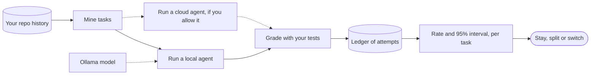
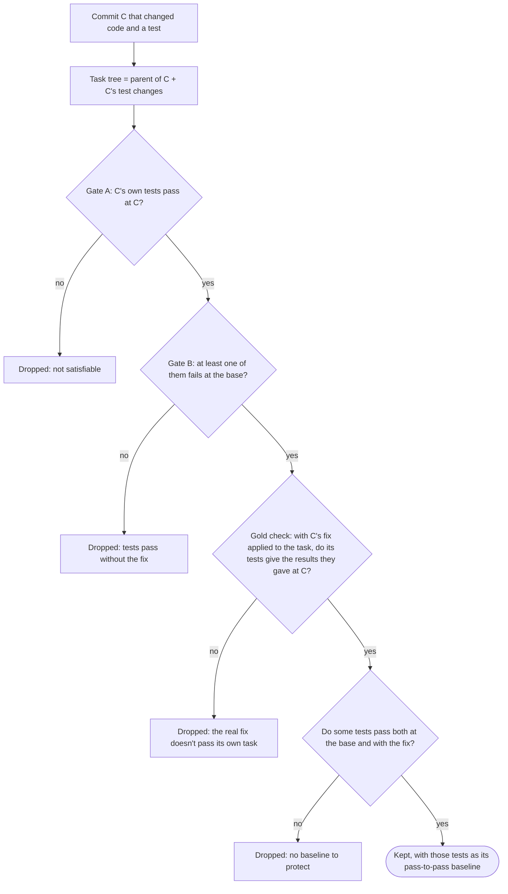
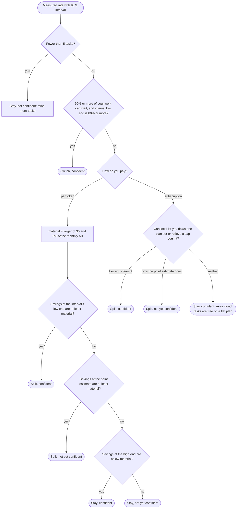

<p align="center">
  <picture>
    <source media="(prefers-color-scheme: dark)" srcset="https://raw.githubusercontent.com/pockanoodles/Mahoraga/main/brand/mark-dark.svg">
    
  </picture>
</p>

<h1 align="center">Mahoraga</h1>

<p align="center">
Mahoraga is a long-term study of where local AI has caught up with cloud AI. It takes real
commits from real repositories, has a model running on hardware people own attempt each one,
and grades every attempt with that repository's own tests. The cloud runs the same tasks, and
every result carries its date, because the line is expected to move. So far local hasn't
caught up on any coding work measured, since on the same 47 tasks a 16 GB laptop solved 17
and Claude Code solved all 47.
</p>

<p align="center">
  <a href="https://github.com/pockanoodles/Mahoraga#the-map-so-far">The map</a> ·
  <a href="https://kaitosoeno.com/mahoraga/">The log</a> ·
  <a href="https://github.com/pockanoodles/Mahoraga/blob/main/docs/report/2026-10-local-coding-ai.md">The report</a> ·
  <a href="https://github.com/pockanoodles/Mahoraga#replicate-it">Replicate it</a> ·
  <a href="https://github.com/pockanoodles/Mahoraga/blob/main/DATAFLOW.md">Data flow</a> ·
  <a href="https://github.com/pockanoodles/Mahoraga/blob/main/CONTRIBUTING.md">Contributing</a>
</p>

[](https://github.com/pockanoodles/Mahoraga/actions/workflows/ci.yml)


## The map so far

Each row is one kind of work, with local and cloud measured on the same tasks. Local has
caught up on a row when even the low end of its 95% interval clears the break-even rate.
That rate is the point where what the cloud spends on the tasks local solves pays for the
developer time spent checking the tasks local fails.

| Work | Local, best measured | Cloud, same tasks | Caught up? | Measured |
| --- | --- | --- | --- | --- |
| Real commits from attrs and more-itertools (47 tasks) | aider and qwen3.5 (9.7B) on a 16 GB MacBook: 17 of 47 (36%, interval 24% to 50%) | Claude Code and Opus 5.5: 47 of 47, at $0.21 a task | No. Break-even is 95% at what the cloud spent | Oct to Nov 2026 |
| The same 47, only the 19 commits made after June 2026 (after both models' training data) | 3 of 19 | 19 of 19 | No | Oct to Nov 2026 |
| Real commits from attrs, more-itertools and click (92 tasks) | aider and qwen3.6 (35B) on a 64 GB Mac Studio: 31 of 92 (34%, interval 25% to 44%) | Not run yet | No. Break-even is 77% at an assumed $0.75 a cloud task | Oct 2026 |

Three measurements are running now, and each adds to the table once it finishes.

- **The same agent on both sides.** Claude Code driving qwen3.5 on the Mac Studio holds the
  agent fixed, so whatever gap remains belongs to the model. It waits on its last tasks and
  on a split by commit date, since a small model may remember a popular library.
- **Every cloud tier.** Sonnet 5.5 and Haiku 5.5 run the same 47 tasks as Opus 5.5, so each
  row can say which tier local has caught up with, if any.
- **New commits every night.** An always-on box mines attrs, more-itertools, click and
  tomlkit for new commits, so each new model also meets work made after its release.

Coding comes first because a commit grades itself with its tests. Another kind of work joins
the map only when it has a check that is just as mechanical, and real tasks behind it. That
way no model ever grades another model's answer. HumanEval+ stays off the map because it is a
public benchmark that both sides have likely trained on. For the record, granite 4.1 (8B)
passed 80.5% of it to Sonnet's 97.6% in August 2026.

[The report](docs/report/2026-10-local-coding-ai.md) holds the full write-up, with every
number linked to the attempts behind it, and the site's
[Research page](https://kaitosoeno.com/mahoraga/) publishes it one finding at a time.

## How a row is measured

Leaderboards measure someone else's tasks on someone else's hardware, so every row here is
built from real commits. One pipeline produces it (source, runner, grader, ledger, verdict),
and it is the same code you run to build your own row on your own repository and machine.

1. **Mine.** Each task is one of your commits with the fix taken out and the tests left
   in. A commit is kept only when its own tests fail without the fix and pass with it, and
   the real fix is then graded the way an attempt would be, so every task is one a correct
   change can pass.
2. **Run.** A local agent (aider or opencode driving an Ollama model) attempts every task
   overnight, each time in a fresh copy of the repository and inside the operating
   system's sandbox (`sandbox-exec` on macOS, bubblewrap on Linux). Claude Code can run
   the same tasks as a cloud arm when you pass `--allow-cloud`, so the cloud side is
   measured too.
3. **Grade.** The tests are put back and the full suite runs, so an attempt counts only
   when the target tests pass and nothing that passed before has broken.
4. **Decide.** The measured rate and its 95% interval, counted over tasks rather than
   attempts, become stay, split or switch, priced for the way you pay (by the token or by
   subscription) and for the time a failed attempt costs you. On API billing,
   `--cloud-arm` prices each task local solves at what a cloud agent spent on the same
   task.



Mining only keeps a commit when the tests it shipped fail without its fix and pass with
it, and the task is the commit's parent with that commit's test changes applied and every
other change (source, docs, config) left out. A task needs the commit to change both
Python source and a pytest module, and the source change to be 250 lines or fewer.

The gold check then applies the commit's real fix to the sealed task and grades it the
way an attempt is graded. The pass-to-pass baseline every attempt is held to is the set of
tests that pass at the base and also pass with the fix, since a test the fix itself breaks
can't be kept passing by any correct change (SWE-bench's definition). With
`--gate-runs K`, gate B and the gold check run K times. A target whose result changes with
the fix applied drops the task, and a test whose result changes between runs is left out of
the baseline, so no attempt is graded on a coin toss.



### The verdict for your own repository

The verdict places your own repository against the same line. It checks both ends of the interval, so it calls a split confidently only when
the pessimistic end still pays, and it is allowed to tell you that you're not wasting
money. In the published run, aider and qwen3.5 (9.7B, 131k context) on a 16 GB MacBook
resolved 17 of 47 tasks from attrs and more-itertools, a rate of 36% with an interval of
24% to 50%. Claude Code on Claude Opus 5.5 resolved all 47 of the same tasks for $0.21
each at API list prices, and for only $0.15 on the 17 the laptop also solved, which is all
a local success saves. At that price local would have to resolve 95% of the tasks it takes
on to break even, so the verdict is a confident stay, since splitting would cost about $77
a month more than it saves.

The rules below are the ones in `backend/orchestrator/audit/verdict.py`. They run on the
task-weighted rate and its Wilson interval, which uses the number of tasks and not the number of attempts, because repeats
of one task are not independent draws. A queued task is one that can wait for an overnight
run, and by default 25% of your cloud tasks count as queueable. Each failed local attempt
is charged 3 minutes of your time at $50 an hour, and each attempt is charged its
electricity (40 W at $0.30 per kWh).



For a per-token user, the savings on queued tasks are `p × cloud cost − local cost − (1 − p) × triage cost`, evaluated at the low end,
the point estimate and the high end of the interval. A task pays to go local once `p` passes `(local + triage) / (cloud + triage)`,
which is the break-even rate the verdict prints (77% for an assumed $0.75 cloud task, and 95% at the $0.15 the cloud arm spent on the tasks local also solved). For a subscription user, the
low end must clear the rate needed to drop a tier, or the user must already be at the cap with
the low end covering at least 10% of their usage. Every assumption prints with the verdict so a reader can disagree with a number
and not only with the call.

With `--cloud-arm` on API billing, the cloud cost stops being an assumption. The verdict
prices each task local solves at what that cloud arm spent on the same task, so a local
success saves only the cloud's own cost for it. On a subscription an extra cloud task costs
nothing, so the flag adds the cloud's row to the output and leaves the call alone. In the published run the tasks local solved cost the cloud
$0.15 each, compared to $0.24 for the rest, because the tasks a small model can solve are
the cheap ones for the cloud too. The cloud arm has to have run every task the local arm
ran, under the same condition (`--cond`) and with a recorded cost for each attempt, or the
verdict refuses, since a partial cloud run would price the verdict on a different set of
tasks.

One rule runs after the call. A timeout can only lower a rate, so when at least 3 failed
attempts ran out of time and they make up half or more of the failures, the rate is a floor
set by the machine's speed. A split or switch read off it still stands, but a stay becomes
not yet confident, and the verdict says that a longer `--timeout` or a smaller context would
measure the model instead.

## Replicate it

The engine installs as a command-line tool. It mines your repository's commits, runs a local
agent on them overnight, and prints your own row and verdict in the morning.

### Install

The PyPI name is `mahoraga-audit` (the name `mahoraga` belongs to an unrelated project).
The command you run is `mahoraga`.

| Channel | Command | Status |
| --- | --- | --- |
| uv | `uv tool install mahoraga-audit` | with the first release |
| pipx | `pipx install mahoraga-audit` | with the first release |
| pip, in a virtualenv | `pip install mahoraga-audit` | with the first release |
| Homebrew | `brew install pockanoodles/tap/mahoraga` | after the first release |
| Docker | `docker run --rm -p 127.0.0.1:8000:8000 ghcr.io/pockanoodles/mahoraga` | after the first release |
| From source | `uv tool install git+https://github.com/pockanoodles/Mahoraga` | CLI and API, no prebuilt app |

uv and pipx give Mahoraga an environment of its own, which its exact pins (uvicorn, httpx
and mcp) need. Installed with plain pip into an environment other tools share, those pins
can clash with theirs, so give it a virtualenv there.

Mahoraga needs Python 3.12 or newer, and it runs on macOS and Linux. It was built on a
16 GB Mac. The Docker image serves the engine and the app, while Ollama and your agents
stay on the host. The Dockerfile's header has the full command,
including the volume that keeps your results.

#### What the audit runs

The audit drives two programs that Mahoraga doesn't install. [Ollama](https://ollama.com/download)
serves the model, and aider is the agent. Install aider in an environment of its own, at the
version the published log measured, because its pins would clash with Mahoraga's:

```bash
uv tool install --python 3.12 aider-chat==0.86.2
```

Before it queues anything, `mahoraga audit tonight` checks both. The doctor command,
`mahoraga audit doctor`, runs the same checks on their own and prints the install line for
anything missing.

The repository's own tests run under its `.venv/bin/python` when there is one, and under
Mahoraga's own interpreter otherwise, which has no pytest when Mahoraga is installed with
uv or pipx. Give the repository a `.venv` with pytest and the project's dependencies, or
name another interpreter with `--python`, or mining will find no task it can run.

### Quick start

```bash
ollama pull qwen3.5:latest

mahoraga audit tonight ~/code/app \
    --tasks-per-month 200 --plan claude-max-5x  # set up a night of runs on your repo

# the next morning
mahoraga audit report ~/code/app
mahoraga audit verdict ~/code/app --arm aider:qwen3.5:latest@ctx=131072 --cond blind
```

`mahoraga audit tonight` does the setup in one go. It mines up to 25 tasks from the
repo's commits that changed both code and a test, checks that the agent, Ollama and the
model are there and that the agent can't see the answer, and queues the run for
21:00–08:00. It then starts the background worker (under launchd on macOS) and tells you
how many nights the run will take. The verdict also needs how many tasks you give cloud
agents a month and how you pay for them. Pass them as above, or `tonight` asks once in
the terminal. They're saved in `usage.json` next to your benches and never leave the
machine. When the job ends, `morning.txt` in the bench directory holds the report and the
verdict, and on macOS a notification gives the resolved count and the call. Each step also has its
own command (`mine`, `doctor`, `queue add`, `service install`) for when you want to run
it by hand. `orch` still works as an alias for `mahoraga`, and `orch agentbench` for
`mahoraga audit`.

To work on Mahoraga itself:

```bash
git clone https://github.com/pockanoodles/Mahoraga.git mahoraga
cd mahoraga
python3 -m venv .venv && source .venv/bin/activate
pip install -r requirements.txt && pip install -e .
mahoraga --help
```

## Privacy

The audit's local arms send nothing off your machine. A cloud arm (`claude:<model>`) runs
only when you pass `--allow-cloud` for that run, and the queue refuses cloud arms, so
nothing unattended sends code. When it does run, Claude Code reads the task's copy of the
repository and its traffic goes through a proxy that allows only api.anthropic.com and
logs every connection. [`DATAFLOW.md`](DATAFLOW.md) lists every place data can go,
including the app's router,
and the privacy policy is at
[kaitosoeno.com/mahoraga/privacy](https://kaitosoeno.com/mahoraga/privacy/).

## Documentation

- [The report: is local coding AI worth it on a 16 GB Mac?](docs/report/2026-10-local-coding-ai.md)
- [The study's direction](brain/decisions/2026-11-08-the-map.md)
- [Where your data goes](DATAFLOW.md)
- [Documentation index](docs/README.md)
- [Getting started](docs/getting-started.md)
- [Configuration](docs/configuration.md)
- [CLI reference](docs/cli-reference.md)
- [Design specifications](docs/specs/)
- [Current research state](brain/state/current_state.md)

Mahoraga also has a local app, an HTTP API, an MCP server and a router between local and
cloud models. They came before the study and no number on the map depends on them, so they
are documented on their own in [`docs/app.md`](docs/app.md).

## Development

```bash
pytest -m "not slow"
```

The project uses `main` as its single trunk. Changes are made on short-lived
branches, validated in CI, and merged through pull requests.

## Limitations

- **The coding rows come from a few Python libraries.** The 47 tasks were mined from attrs
  and more-itertools, and the 92 add click. These are small, well-tested and widely read, so
  a model may have seen them in training, and your repository can give a different rate.
  For that reason the report also counts each model on the commits made after its release
  or its stated knowledge cutoff, which it can't have trained on.
- **The cloud comparison is agent plus model.** Claude Code can run the tests through its
  own shell under `blind` while aider can't, so the 47-to-17 gap compares the two setups
  as they ship. The Claude Code run on qwen3.5 listed under the map holds the agent fixed
  from the local side, which separates the two.
- **A resolved task passed its tests, which is a lower bar than a merged change.** The
  grader checks the commit's own tests and every test that passes both before the commit
  and with its fix, and it can't judge style, scope or whether a maintainer would accept
  the patch.
- **The local rows ran on two Macs.** The small models ran on a 16 GB MacBook and the 35B
  model on a 64 GB Mac Studio. On the same model file at the same setting, the Studio
  resolved 18 of the laptop's 47 tasks to the laptop's 17, a difference chance alone
  explains. The machine changes which models fit more than how well one model does.

## Related work

Mahoraga shares its mining recipe with other tools and benchmarks. What it adds is the map. It
measures a local machine beside the cloud on the same real tasks, prices the gap for the
reader's bill and time, and measures again as models change. The landscape on 2026-11-07, with a confidence tag on each
source, is in [`brain/research/2026-11-07-landscape.md`](brain/research/2026-11-07-landscape.md).

- **Tools that mine your own repository.** SelfBench, RepoTrials and Hugging Face's
  Tasksmith turn a repository's merged changes into private tasks with fail-before and
  pass-after checks, and RepoTrials also runs the real fix, as Mahoraga's gold check does.
  None of them gives a verdict or runs a local model beside the cloud on the same tasks.
- **Fresh public tasks.** SWE-rebench scores agents on recently mined GitHub tasks with
  intervals and a cost per problem, and RuBench (2026) mined fix commits from live
  repositories after the models' cutoffs and audited each agent's trajectory for attempts
  to find the answer.
- **Local against cloud.** Intelligence per Watt (Hazy Research, 2025) found local models
  answer most single-turn chat and reasoning queries, which leaves open the agentic case
  this study measures. Epoch AI tracks how far open models, and models that fit one
  consumer GPU, trail the frontier.
- **What a passing test is worth.** METR (2026) had maintainers review AI patches that
  passed the tests, and they would have merged about 24 points fewer than the grader
  passed, so a resolve rate is an upper bound on mergeable work for local and cloud alike.
- **The agent as a variable.** Two 2026 studies measured the harness alone. Under a short
  context, trimming old tool results raised an open model's complete solutions from 43 to
  72 of 169 tasks, while two frontier models scored about the same under their own harness
  and a neutral one.

## Name

Mahoraga takes its name from a figure in Buddhist tradition. It is not affiliated with Jujutsu Kaisen, Gege Akutami or Shueisha.

## License

MIT